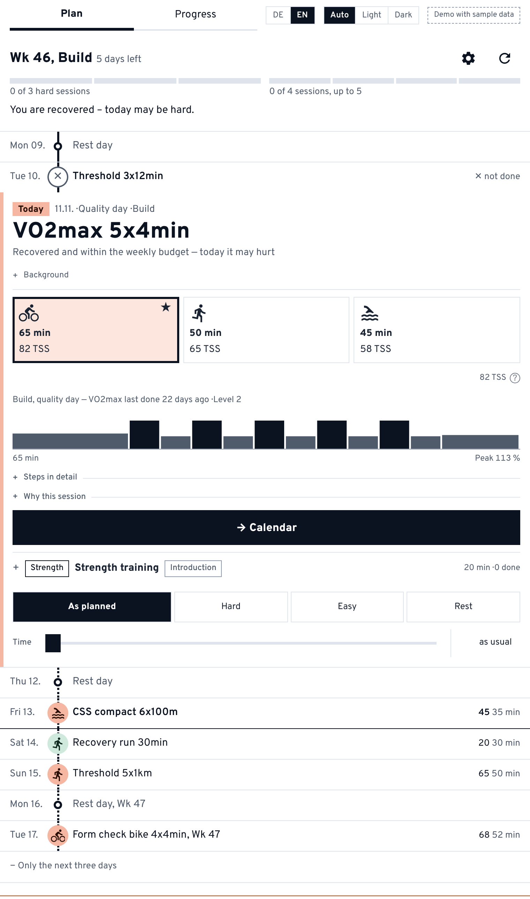
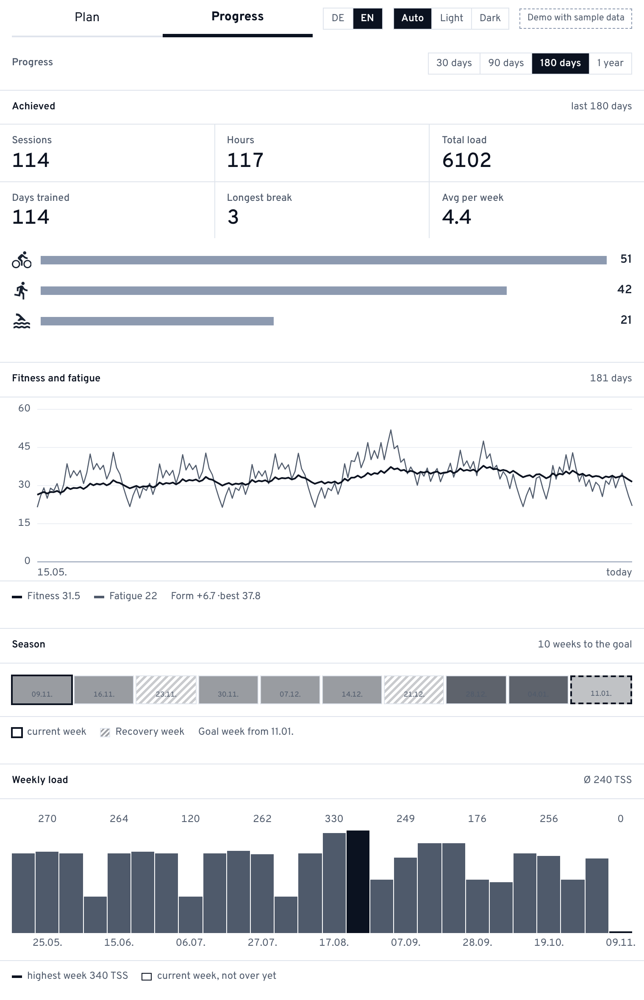
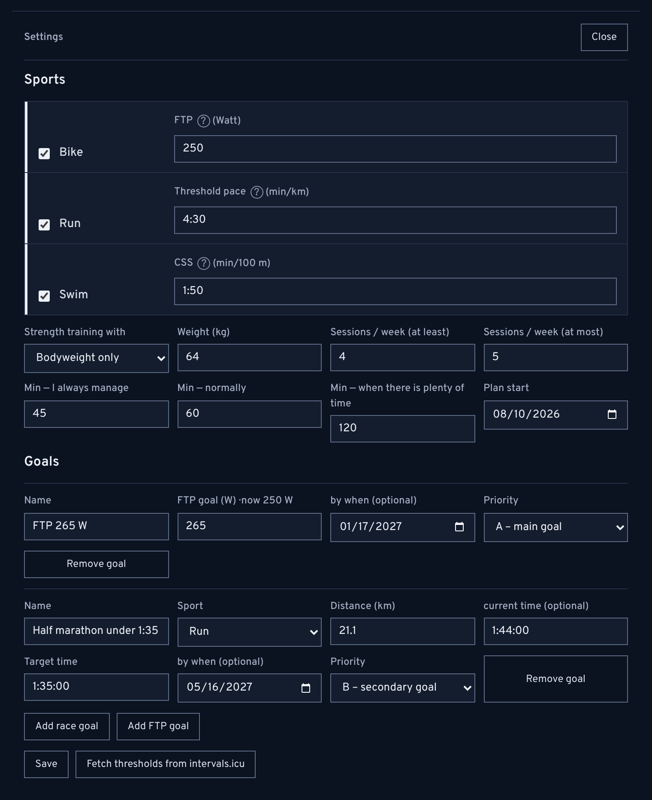

# Formkurve

A training planner for endurance athletes. It reads the last months of training and
wellness data from [intervals.icu](https://intervals.icu) and plans the next three days
of cycling, running and swimming. Each day shows every sport as an equal alternative,
recommends the one that helps most today, and offers each session in a shorter version
for days that turn out busier than planned.

I built it for my own training and use it myself. The repository and the Cloudflare
Worker are still called `intervals-coach`.

## Screenshots

| Plan | Progress | Settings |
|---|---|---|
|  |  |  |

Taken from the demo, which runs on synthetic data for a fictional athlete.

## What it does

- **Plans from what actually happened.** Fitness and fatigue (CTL/ATL/TSB), a readiness
  score from HRV, resting heart rate and sleep against a 30-day baseline, and a training
  phase derived from the next goal. A missed week or a spontaneous hard day shifts the
  plan instead of breaking it.
- **Three time budgets instead of one limit.** Every session comes in an "always works",
  a "normal" and a "good day" version, shortened by rules that keep the training stimulus.
  A time slider adds easy base to the session on a day with more time — never more
  intervals — for as long as the time set, saying where that goes past what fitness and
  recent long sessions suggest. A second slider sets the minute the intervals begin.
- **Recognises completed sessions** from time in zones, unlocks the next progression
  level, schedules a benchmark session every eight weeks and suggests threshold updates.
- **Checks heart-rate recordings** against the work done, flags wrist-sensor artefacts
  and estimates the affected segments, clearly marked as estimates.
- **Reads rides recorded without power or heart rate** from speed and the elevation
  profile: estimates the load so the ride counts, and finds the sets of the session it
  was paired with — marked as an estimate, never enough on its own to unlock a level.
- **Sends workouts** to the intervals.icu calendar and on to Zwift, Wahoo or Garmin, and
  optionally writes a summary to the matching Strava activity.
- **The whole week on request.** The plan stands for three days; one tap shows seven,
  with the days past the third marked as an outlook that shifts with what is trained
  until then.
- **German and English.** The interface and everything the coach writes — reasons, notes,
  workout names, the text sent to the calendar — follow the browser's language or the
  switch at the top. The legal pages are German only.
- **Installs as an app.** A service worker keeps the program files, so it opens at once
  and says so when it is offline. Training and health data are never cached.
- **Single-user and multi-user mode:** a password-protected personal deployment, or
  "Sign in with intervals.icu" via OAuth.

## Stack

React 19 · TypeScript · Vite · Hono · Cloudflare Workers + KV · Vitest · Playwright · Biome · GitHub Actions

## Getting started

```bash
cp .env.example .env        # intervals.icu API key + athlete ID
npm install
npm run dev                 # API on :8787, UI on :5173
npm test                    # Vitest
npm run lint                # Biome
npm run e2e                 # Playwright against the local demo Worker
npm run demo:preview        # plan from synthetic data, no API access needed
```

Deployment to Cloudflare Workers (`npm run deploy`), the GitHub Actions workflow and the
multi-user setup are described in the full documentation (German):
[docs/README.de.md](docs/README.de.md).

**Demo:** a separate Worker (`npm run deploy:demo`) runs the app on synthetic data for a
fictional athlete, without intervals.icu and without any real data. Every visitor gets
their own sandbox that expires after two hours. Details (German): [docs/demo.md](docs/demo.md).

<!-- DEMO LINK: add the URL of the demo Worker here -->


## What mattered to me

- **Testable domain logic.** All training logic lives in `src/coach/` without any I/O.
  It is covered by around 85 Vitest files, and a failing test blocks the deployment.
  Browser tests drive the demo Worker end to end.
- **Honest UX.** Estimated values are marked as such, optional sessions are labelled
  optional, and nothing is written back to intervals.icu without an explicit
  confirmation that says what will change.
- **Privacy by design.** HRV, resting heart rate and sleep are health data. Training and
  health data are fetched on each request and never stored; OAuth tokens are encrypted
  with AES-GCM; sessions use signed `HttpOnly` cookies; logins are rate-limited; OAuth
  scopes are kept minimal; fonts are self-hosted so no visitor IP goes to third parties.
- **A deliberate visual direction** ("measuring instrument"), with light and dark mode
  applied before the first render.

## License

All rights reserved. The source code is visible but not licensed for use, copying or
modification.
